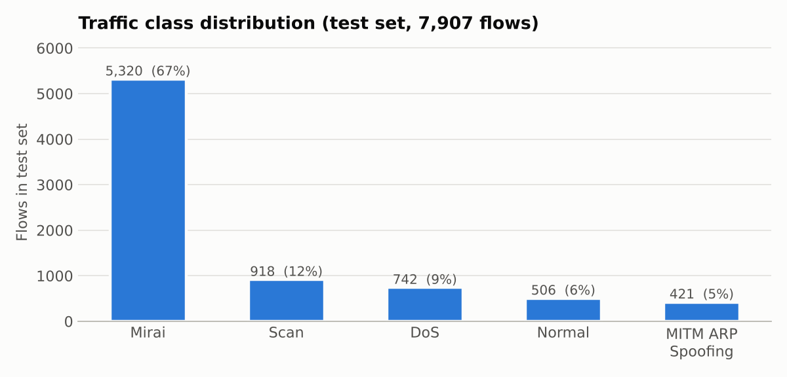
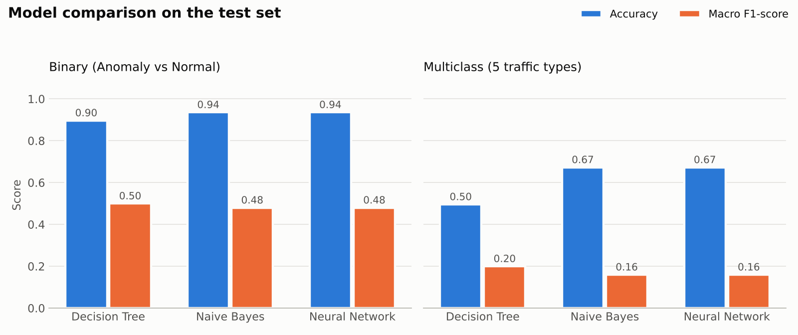
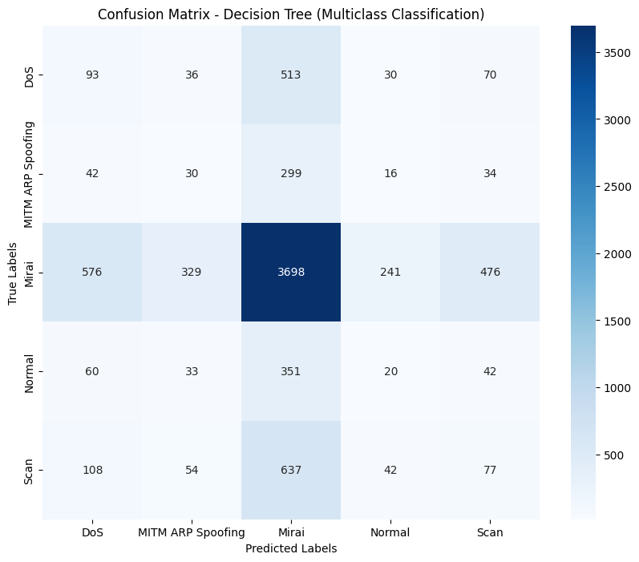
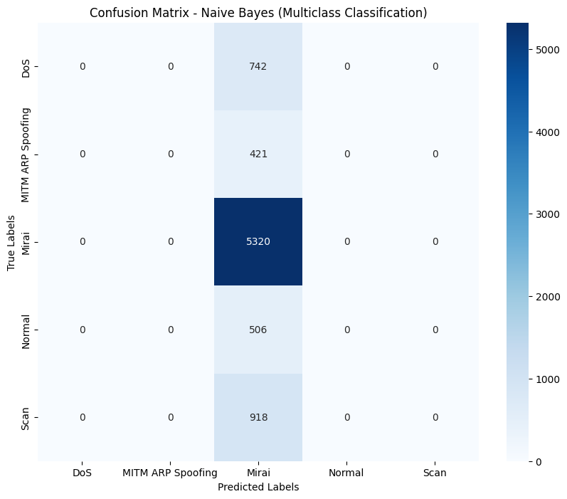
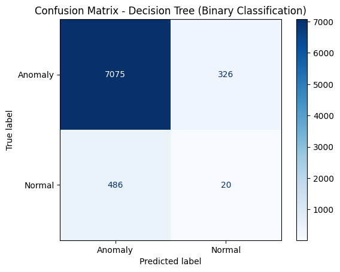
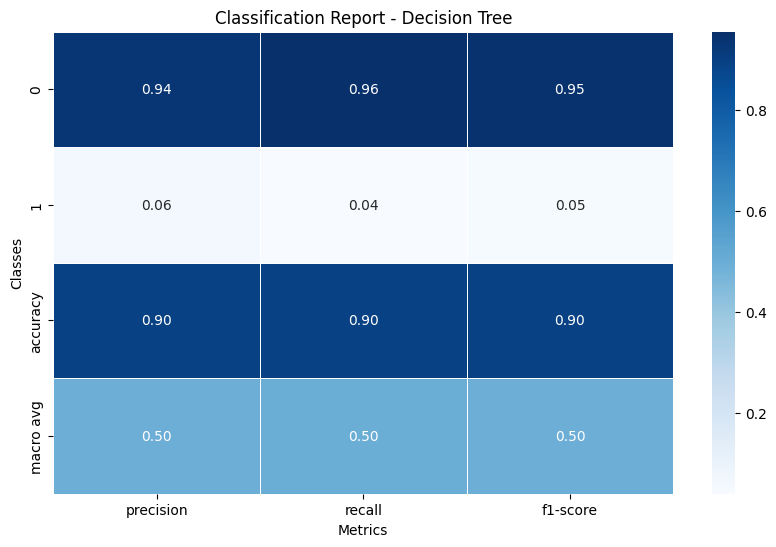

# IoT Network Intrusion Detection – A Comparative Study of ML Models

Detecting and classifying cyberattacks in IoT network traffic using **Decision Tree**, **Gaussian Naive Bayes**, and a **Neural Network**, trained on the **IoTID20** dataset.

---

## Overview

Smart homes, cameras, and connected devices make up a fast-growing part of today's networks, and they are frequent targets of attacks such as botnets, denial-of-service floods, and network scanning. Monitoring this traffic by hand is not feasible at scale.

This project builds a machine learning pipeline that analyses network-flow statistics and:

1. **Detects** whether a flow is **normal or anomalous** (binary classification), and
2. **Identifies the type of attack**: DoS, MITM ARP Spoofing, Mirai, Scan, or Normal (multiclass classification).

Three models from different families (tree-based, probabilistic, and neural) are trained and compared on both tasks to understand how each approach handles real IoT traffic.

---

## Objectives

- Build an end-to-end pipeline from raw network flows to trained classifiers.
- Compare a **Decision Tree**, **Gaussian Naive Bayes**, and a **feed-forward Neural Network**.
- Evaluate models beyond accuracy, using **precision, recall, F1-score, and confusion matrices**.
- Study how the **class distribution** of IoT attack data shapes model behaviour.

---

## 📂 Dataset

**IoTID20** contains network traffic captured from a smart-home testbed with IoT devices such as smart speakers and Wi-Fi cameras.

| Property | Value |
|---|---|
| Records | ~625,000 network flows |
| Columns | 86 (flow features + labels) |
| Feature examples | flow duration, forward/backward packet counts, packet lengths, inter-arrival times, flag counts, idle/active times |
| Binary label | Anomaly / Normal |
| Category label | DoS, MITM ARP Spoofing, Mirai, Normal, Scan |

<p align="center">
  
</p>

The data is highly **imbalanced**: Mirai botnet traffic makes up about two-thirds of the flows, which reflects how dominant botnet activity is in real IoT attack captures.

> The dataset is not included in this repository. It can be downloaded from [Kaggle](https://www.kaggle.com/search?q=IoTID20).

---

## Methodology

```
Raw flows ─► Cleaning ─► Encoding ─► Outlier removal ─► Train/test split ─► Model training ─► Evaluation
```

1. **Data cleaning:** replaced infinite values with NaN and removed incomplete rows.
2. **Encoding:** label-encoded categorical columns (flow ID, IP addresses, timestamp) and both target labels.
3. **Outlier removal:** filtered extreme values using the **IQR (interquartile range)** rule.
4. **Train/test split:** 80% training, 20% testing (7,907 test flows).
5. **Model training:** each model was trained separately for the binary and multiclass tasks.
6. **Evaluation:** accuracy, per-class precision/recall/F1, macro averages, and confusion matrices.

### Models

| Model | Type | Configuration |
|---|---|---|
| **Decision Tree** | Tree-based | scikit-learn `DecisionTreeClassifier` (default settings) |
| **Gaussian Naive Bayes** | Probabilistic | scikit-learn `GaussianNB` |
| **Neural Network** | Deep learning | Keras: Dense(64, ReLU) → Dense(32, ReLU) → Sigmoid (binary) / Softmax (multiclass); Adam optimizer |

---

## Results

### Model comparison

<p align="center">
  
</p>

| Model | Binary accuracy | Binary macro F1 | Multiclass accuracy | Multiclass macro F1 |
|---|---|---|---|---|
| Decision Tree | 89.7% | 0.50 | 49.6% | 0.20 |
| Gaussian Naive Bayes | 93.6% | 0.48 | 67.3% | 0.16 |
| Neural Network | 93.6% | 0.48 | 67.3% | 0.16 |

### Confusion matrices

<p align="center">
  
  
</p>

<p align="center">
  
  
</p>

### Per-class performance (Decision Tree, multiclass)

| Class | Precision | Recall | F1-score | Test samples |
|---|---|---|---|---|
| DoS | 0.11 | 0.13 | 0.11 | 742 |
| MITM ARP Spoofing | 0.06 | 0.07 | 0.07 | 421 |
| Mirai | 0.67 | 0.70 | 0.68 | 5,320 |
| Normal | 0.06 | 0.04 | 0.05 | 506 |
| Scan | 0.11 | 0.08 | 0.10 | 918 |

---

## Key Insights

- **Accuracy and F1 tell different stories.** Naive Bayes and the Neural Network reached the highest accuracy, but their macro F1-scores show that their predictions concentrated on the dominant class. On imbalanced security data, macro F1 and per-class recall are the more meaningful measures.
- **The Decision Tree distributes predictions across all classes.** Although its overall accuracy is lower, it was the only model that predicted every attack type, which makes it the most informative baseline for multiclass detection.
- **Mirai is the easiest class to recognise**, with an F1-score of 0.68, largely because it dominates the training data.
- **Class distribution drives model behaviour.** The results show why handling imbalance is central to building intrusion detection systems that catch rarer but critical attacks such as MITM ARP spoofing.

---

## Future Enhancements

- Apply **class balancing** (class weights, SMOTE, or stratified sampling) so minority attacks receive more attention.
- Add **feature scaling** and **feature selection** to focus on the most informative flow statistics.
- Try **ensemble models** such as Random Forest, XGBoost, or LightGBM, which perform strongly on tabular network data.
- Tune neural network depth, regularisation, and training schedule.
- Explore **real-time detection** on streaming network traffic.

---

## Tech Stack

**Language:** Python  
**Data processing:** pandas, NumPy  
**Machine learning:** scikit-learn  
**Deep learning:** TensorFlow / Keras  
**Visualisation:** Matplotlib, Seaborn

---

## 📁 Project Structure

```
iot-intrusion-detection-ml/
├── notebooks/
│   └── iot_intrusion_detection.ipynb   # full pipeline: preprocessing, training, evaluation
├── images/                             # figures used in this README
├── requirements.txt
└── README.md
```

## ▶️ How to Run

```bash
git clone https://github.com/Muniba-Manaal/iot-intrusion-detection-ml.git
cd iot-intrusion-detection-ml
pip install -r requirements.txt
```

Download `IoTID20.csv`, update the file path in the notebook, and run `notebooks/iot_intrusion_detection.ipynb` in Jupyter or Google Colab.

---

## 👩‍💻 Author

**Muniba Manaal**, AI Engineer  
[GitHub](https://github.com/Muniba-Manaal) · [LinkedIn](https://www.linkedin.com/in/muneebamanaal/) · [Portfolio](https://munibamanaal.github.io/portfolio/)
